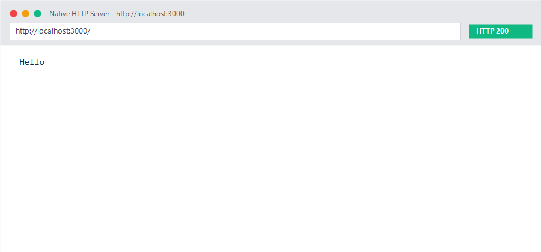
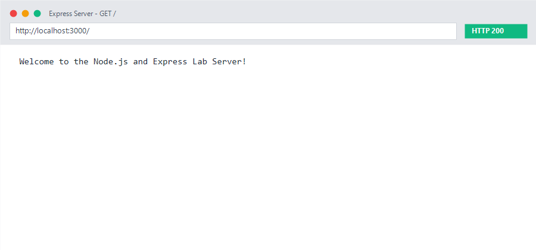
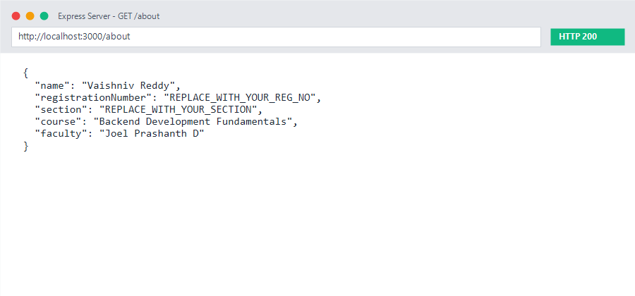
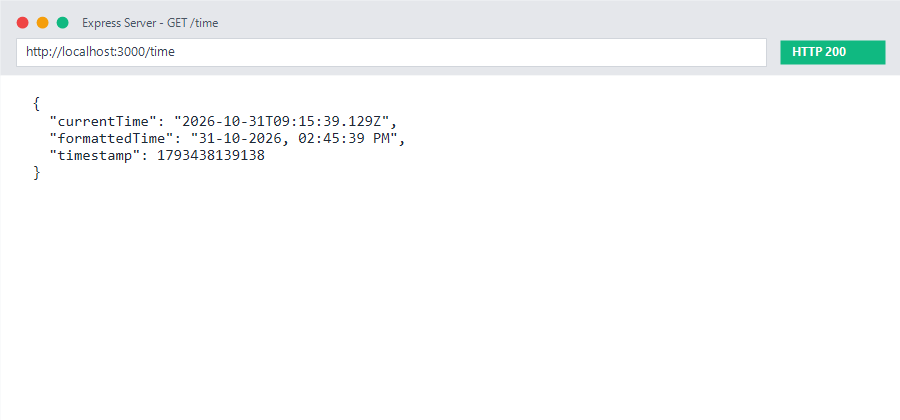
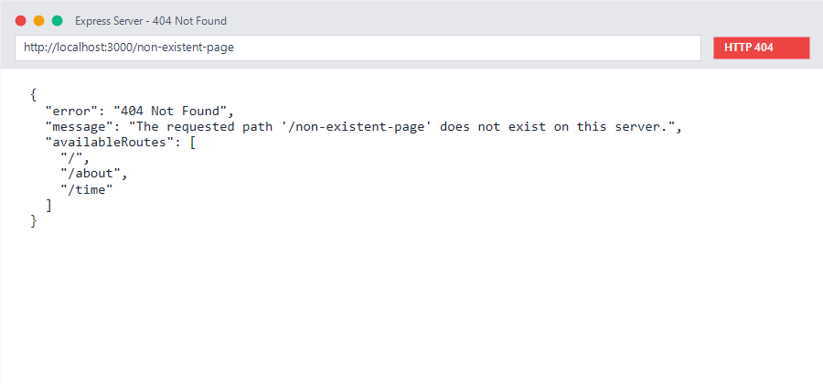

# Lab 1: Node.js and Express server

**Student Name:** Vaishniv Reddy  
**Registration Number:** REPLACE_WITH_YOUR_REG_NO  
**Section:** REPLACE_WITH_YOUR_SECTION  
**Course:** Backend Development Fundamentals (Year II Term II)  
**Faculty:** Joel Prashanth D  

---

## Live Link
- **Live URL:** [Deploy on Render / Railway / NxtWave Cloud IDE](https://your-deployment-link.onrender.com) *(Update with your active deployment link or specify 'Not deployed yet: local verification completed with Postman/browser captures below')*

---

## How to Run

### 1. Prerequisites
- Node.js (version 18 or higher recommended)
- npm (Node Package Manager)

### 2. Environment Variables
Create an optional `.env` file in the root of `lab-01/` if port customization is required (do not commit this file):
```env
PORT=3000
```

### 3. Installation
Navigate into the `lab-01` directory and install project dependencies:
```bash
cd lab-01
npm install
```

### 4. Running the Servers

- **Plain HTTP Server (Built-in `http` module):**
  ```bash
  node native_server.js
  ```
  Accessible at: `http://localhost:3000`

- **Express Server (Full Lab Implementation):**
  ```bash
  node server.js
  ```
  Accessible at: `http://localhost:3000`

---

## Endpoints Table

| HTTP Method | Endpoint | Description | Status Code |
| :--- | :--- | :--- | :--- |
| `GET` | `/` | Returns welcome text message | `200 OK` |
| `GET` | `/about` | Returns student details (Name, Reg No, Section) in JSON | `200 OK` |
| `GET` | `/time` | Returns dynamic current date & time generated using `new Date()` | `200 OK` |
| `*` | Any undefined path | Fallback handler returning error and list of valid paths | `404 Not Found` |

---

## package.json Fields Explanation

- `"name"`: The unique identifier/name of the project package.
- `"version"`: Current semantic version of the project (e.g., `1.0.0`).
- `"description"`: Brief explanation of what the project/package does.
- `"main"`: The entry point file executed when the package is started or imported (e.g., `server.js`).
- `"scripts"`: Aliases for commands to automate tasks like `npm start` or `npm test`.
- `"keywords"`: Descriptive tags for searchability in package registries.
- `"author"`: The author or maintainer of the project.
- `"license"`: Legal licensing terms governing usage and distribution (e.g., `ISC` or `MIT`).
- `"dependencies"`: Third-party modules and libraries required at runtime (e.g., `express`).

---

## Screenshots

Screenshots should be stored inside the `screenshots/` directory and referenced below:

### 1. Plain HTTP Server (`/`)


### 2. Express Server Root (`GET /`)


### 3. Express About Route (`GET /about`)


### 4. Express Time Route (`GET /time`)


### 5. 404 Error Handling (`GET /unknown`)


---

## Notes: Problems Faced and How You Solved Them

1. **Native HTTP vs Express Routing**:
   - *Problem:* Routing with native `http.createServer` requires manually inspecting `req.url` and `req.method` using conditional blocks or `switch` statements, which becomes tedious and error-prone.
   - *Solution:* Migrated to Express, which provides declarative HTTP verb routing methods (`app.get()`, `app.post()`) and clean middleware chaining.

2. **404 Route Catch-all**:
   - *Problem:* In native HTTP, unhandled URLs hang if not explicitly terminated with `res.end()`.
   - *Solution:* Implemented Express catch-all middleware positioned after all route definitions, ensuring any unmapped endpoint returns a clear JSON response and HTTP status `404`.

3. **Port Conflicts & Dynamic Porting for Deployment**:
   - *Problem:* Cloud deployment platforms (like Render or Railway) assign dynamic ports via environment variables instead of hardcoded port 3000.
   - *Solution:* Used `process.env.PORT || 3000` to seamlessly accommodate local execution and cloud environments.

---

## Viva Preparation Guide

1. **What is the difference between `package.json` and `node_modules`?**
   - `package.json` is a metadata manifest file that lists project information, scripts, and package version specifications. It is small, human-readable, and committed to Git.
   - `node_modules` is the actual directory containing the downloaded executable code and files of all installed dependencies and their sub-dependencies. It is large, machine-specific, and must **never** be committed to Git.

2. **What does `app.listen()` do?**
   - It binds and listens for incoming connections on the specified port and host. Under the hood, it creates a Node `http.Server` and calls its native `.listen()` method to begin accepting network requests.

3. **What do `request` (`req`) and `response` (`res`) represent?**
   - `request` (`req`): An object representing the incoming HTTP request, containing data such as HTTP headers, query parameters, URL path, HTTP method, and body payload sent by the client.
   - `response` (`res`): An object representing the outgoing HTTP response, used by the server to send HTTP status codes, headers, and data (HTML, JSON, plain text) back to the client.

