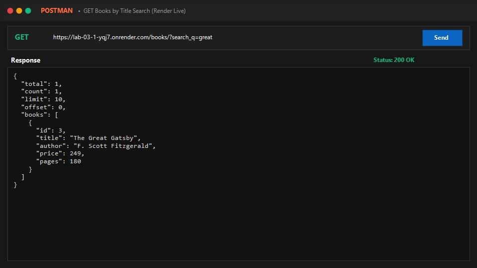
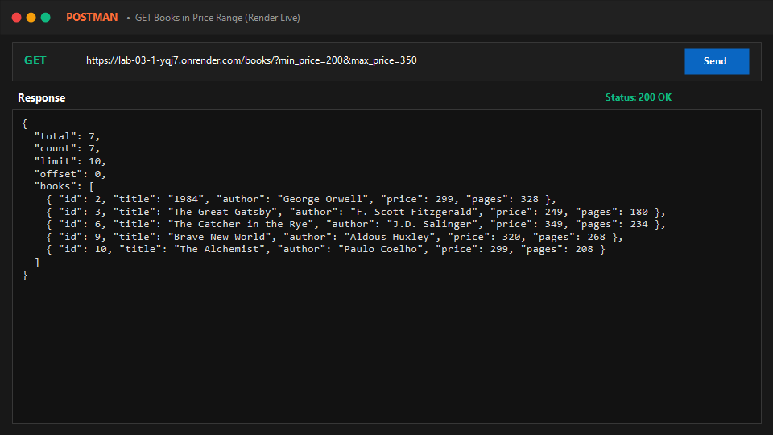
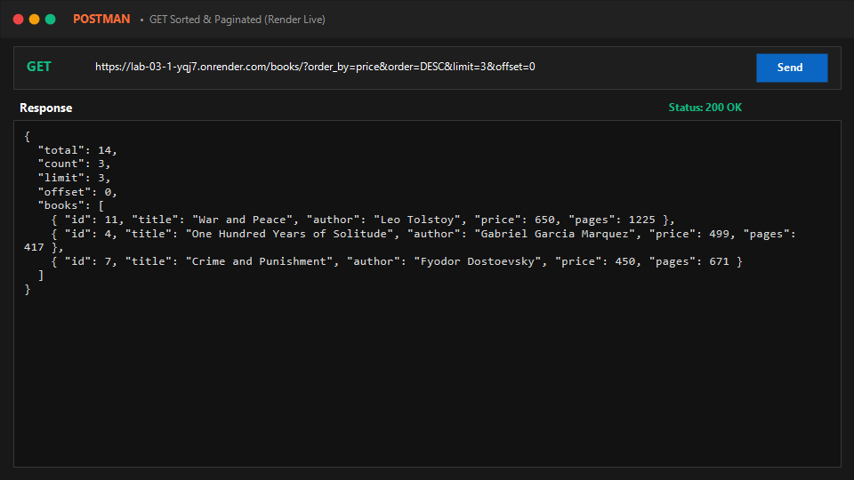
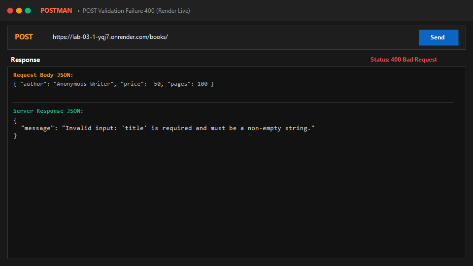
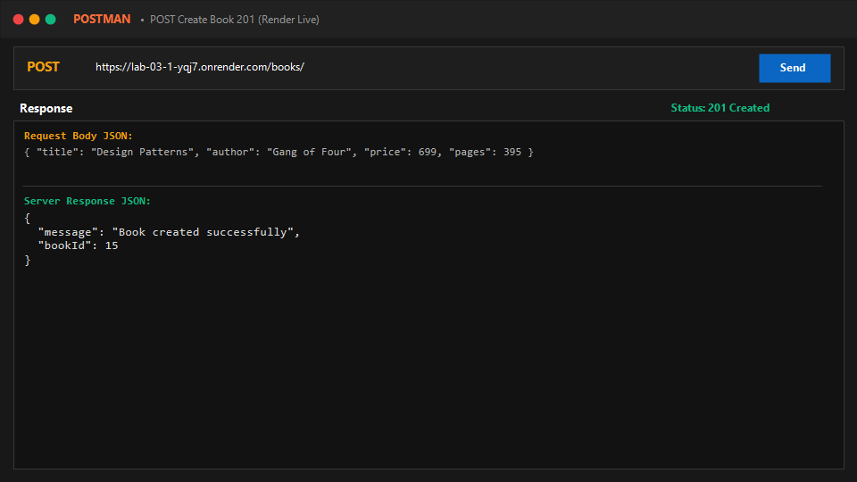
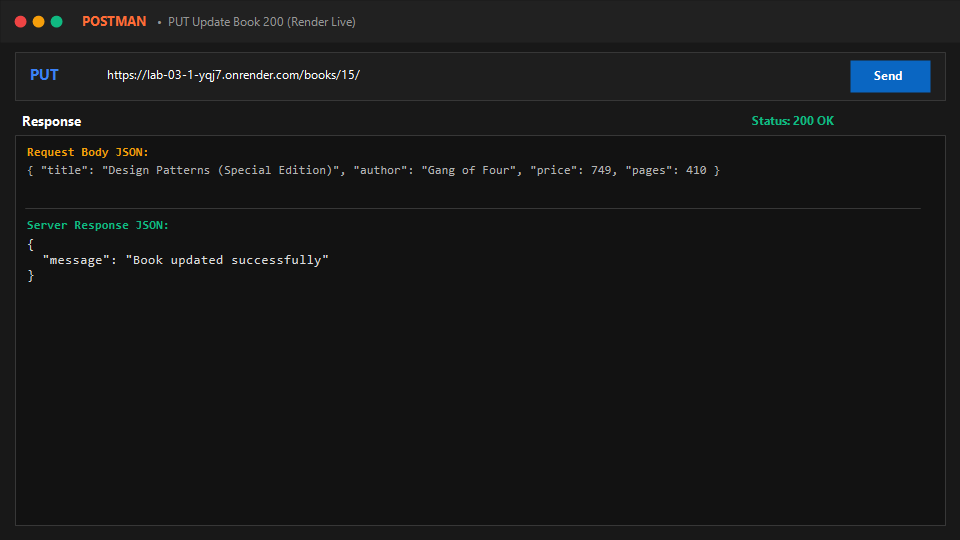
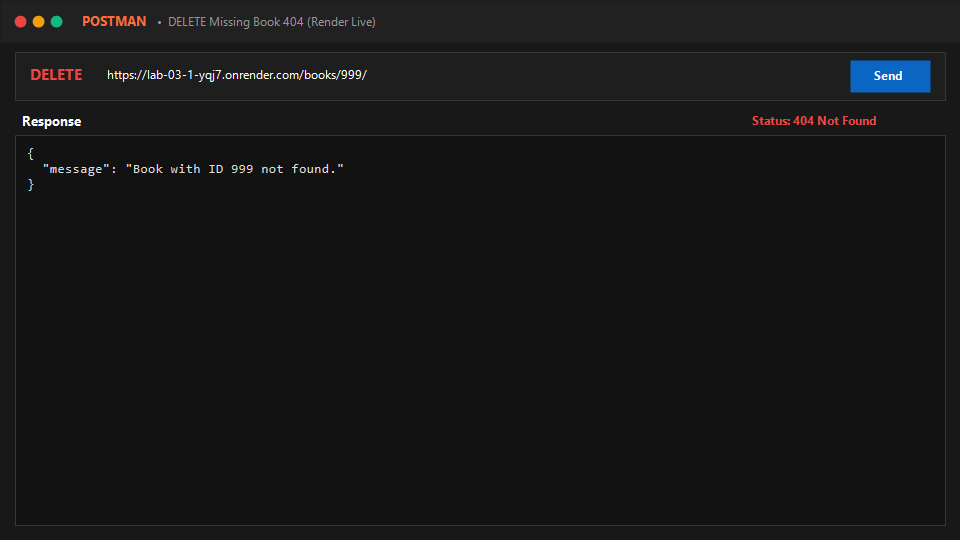

# Lab 3: REST API, query parameters, validation, debugging

**Student Name:** Vaishniv Reddy  
**Registration Number:** 252U1R1171  
**Section:** CSE-2D 214  
**Course:** Backend Development Fundamentals (Year II Term II)  
**Faculty:** SHIVA SAI TEJA  

---

## Live Links & Repositories
- **Public Live URL:** [https://lab-03-1-yqj7.onrender.com/](https://lab-03-1-yqj7.onrender.com/)
- **Dedicated Repository:** [https://github.com/vaishnavreddy5626/lab-03](https://github.com/vaishnavreddy5626/lab-03)
- **Course Monorepo:** [https://github.com/vaishnavreddy5626/backend-labs/tree/main/lab-03](https://github.com/vaishnavreddy5626/backend-labs/tree/main/lab-03)
- **Deploy Status:** [](https://render.com/deploy?repo=https://github.com/vaishnavreddy5626/lab-03)

---

## How to Run

### 1. Prerequisites
- Node.js (v18+)
- npm

### 2. Installation
```bash
cd lab-03
npm install
```

### 3. Execution Commands
- **Database Seeding (Creates `goodreads.db` & seeds 14 books):**
  ```bash
  npm run seed
  ```
- **Development Server (Auto-reloading with nodemon):**
  ```bash
  npm run dev
  ```
- **Production Server:**
  ```bash
  npm start
  ```
- **Automated Test Suite (15 Test Cases):**
  ```bash
  npm test
  ```

---

## REST API Endpoints & Query Parameters

### Base Endpoints

| HTTP Method | Endpoint | Description | Request Body Payload | Status Code |
| :--- | :--- | :--- | :--- | :--- |
| `GET` | `/` | API Overview & Documentation | *None* | `200 OK` |
| `GET` | `/books/` | List books with search, filter, sort & pagination | *None* (uses query parameters) | `200 OK` |
| `GET` | `/books/:bookId/` | Retrieve a single book by ID | *None* | `200 OK` / `404 Not Found` |
| `POST` | `/books/` | Create a new book with payload validation | `{ "title": "...", "author": "...", "price": 550, "pages": 400 }` | `201 Created` / `400 Bad Request` |
| `PUT` | `/books/:bookId/` | Update existing book with validation | `{ "title": "...", "author": "...", "price": 600, "pages": 420 }` | `200 OK` / `400 Bad Request` / `404 Not Found` |
| `DELETE` | `/books/:bookId/` | Delete book by ID | *None* | `200 OK` / `404 Not Found` |

---

### `GET /books/` Query Parameters

| Parameter | Type | Default | Description | Example Query |
| :--- | :--- | :--- | :--- | :--- |
| `search_q` | String | `""` | Partial title search using SQL `LIKE %...%` | `?search_q=great` |
| `min_price` | Number | `undefined` | Filter books with price greater than or equal | `?min_price=200` |
| `max_price` | Number | `undefined` | Filter books with price less than or equal | `?max_price=400` |
| `order_by` | String | `"id"` | Column to sort by (`id`, `title`, `author`, `price`, `pages`) | `?order_by=price` |
| `order` | String | `"ASC"` | Sort direction (`ASC` or `DESC`) | `?order=DESC` |
| `limit` | Number | `10` | Number of results to return per page | `?limit=5` |
| `offset` | Number | `0` | Number of results to skip for pagination | `?offset=5` |

---

## Input Validation Rules (`POST` & `PUT`)

All mutation endpoints enforce strict validation middleware and return structured error messages `{ "message": "..." }`:
1. **`title`**: Required, non-empty string.
2. **`author`**: Required, non-empty string.
3. **`price`**: Required, non-negative number ($\ge 0$).
4. **`pages`**: Required, positive integer ($> 0$).

---

## Screenshots (Postman Success & Failure Cases)

### 1. Title Search (`search_q=great`)


### 2. Price Range Filter (`min_price=200&max_price=350`)


### 3. Sorting & Pagination (`order_by=price&order=DESC&limit=3&offset=0`)


### 4. Validation Failure — 400 Bad Request (Missing Title / Negative Price)


### 5. Successful POST — 201 Created


### 6. Successful PUT — 200 OK


### 7. Non-Existent Record — 404 Not Found


---

## Debugging Exercise: 4 Common Errors & Solutions

### 1. Port Conflict (`EADDRINUSE`)
- **Error:** `Error: listen EADDRINUSE: address already in use :::3000`
- **Cause:** Another process or previous server instance is already running on port 3000.
- **How to Identify:** Run `netstat -ano | findstr :3000` (Windows) or `lsof -i :3000` (macOS/Linux) to locate the process ID (PID).
- **Solution:** Terminate the conflicting process (`Stop-Process -Id <PID> -Force` or `kill -9 <PID>`), or configure dynamic port allocation via environment variables:
  ```javascript
  const PORT = process.env.PORT || 3000;
  ```

### 2. Wrong Import Path
- **Error:** `Error: Cannot find module './db' or 'MODULE_NOT_FOUND'`
- **Cause:** Incorrect relative directory path (e.g. `require('./db')` instead of `require('./database/db')`) or omitting necessary package names.
- **Solution:** Verify the file path using Node's path resolution and standardize imports with `path.join(__dirname, ...)`:
  ```javascript
  const { open } = require('sqlite');
  const sqlite3 = require('sqlite3');
  const dbPath = path.join(__dirname, 'goodreads.db');
  ```

### 3. Table-Name Typo (`no such table`)
- **Error:** `SQLITE_ERROR: no such table: books`
- **Cause:** Querying `FROM books` when the table was defined in singular form as `book`.
- **Solution:** Inspect schema using SQLite CLI (`sqlite3 goodreads.db ".schema"`) and ensure consistent table identifiers across queries:
  ```sql
  CREATE TABLE IF NOT EXISTS book (...);
  SELECT * FROM book WHERE id = ?;
  ```

### 4. Missing `await` in Database Calls
- **Error:** Returned response contains empty objects `{}`, unresolved Promises `Promise { <pending> }`, or causes `UnhandledPromiseRejection`.
- **Cause:** Calling asynchronous SQLite driver methods (`db.all()`, `db.get()`, `db.run()`) without the `await` keyword in an `async` handler.
- **Solution:** Always prefix asynchronous database queries with `await`:
  ```javascript
  // Incorrect:
  const books = db.all(query, params); // returns Promise { <pending> }

  // Correct:
  const books = await db.all(query, params); // resolves to array of records
  ```

---

## Viva Preparation Guide

1. **Query parameter vs Path parameter?**
   - **Path Parameters** (`/books/:bookId`): Form part of the URL path used to identify a specific, unique resource (e.g., book with ID 1).
   - **Query Parameters** (`/books?search_q=gatsby&order_by=price`): Key-value pairs appended after `?` used to filter, sort, search, or paginate resources without altering the resource endpoint itself.

2. **What does stateless mean in REST?**
   - A REST API is **stateless** because the server does not store any client session context between requests. Each HTTP request from the client must contain all the information necessary for the server to understand and process that request independently (e.g., authentication tokens, parameters, request body).

3. **Which status code is used for bad input vs a missing record?**
   - **`400 Bad Request`**: Used for invalid, malformed, or missing client input (e.g., negative price, missing required title).
   - **`404 Not Found`**: Used when the input syntax is valid, but the requested resource URI or specific ID does not exist on the server (e.g., `/books/999` where book ID 999 is not in the database).

